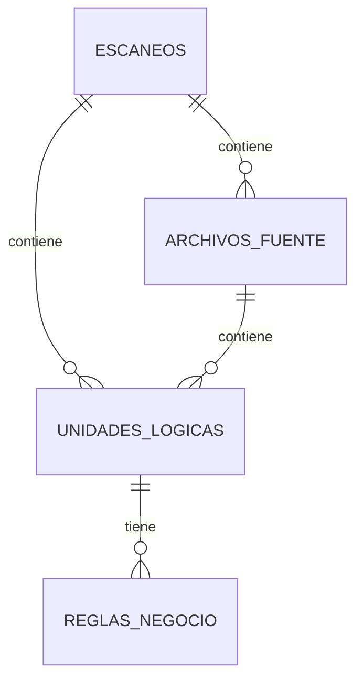

# Diccionario de Datos — Code-Agent (Schema A-ONE)
**Versión:** 2.0 | **Fecha:** 2026-03-09 | **Schema:** `code_agent`

> [!NOTE]
> Versión consolidada unificando el diccionario de datos interno con el gap analysis del schema A-ONE.
> Motor: PostgreSQL 15+. Usar `JSONB` para columnas JSON.

---

## Diagrama de Relaciones (ERD)

---

## 1. Tabla: `escaneos`
> Cada fila = un análisis completo de un microservicio/repositorio.

| Columna | Tipo | Nullable | Default | Descripción |
|---|---|---|---|---|
| `id` | `UUID_V7` (PK) | NO | `uuid_generate_v7()` | Identificador único del escaneo |
| `activo_id` | `UUID_V7` (FK) | NO | — | FK → `infra.activos.id` |
| `aplicacion_id` | `UUID_V7` (FK) | NO | — | FK → `producto.aplicaciones.id` |
| `microservice_name` | `VARCHAR(255)` | SÍ | — | Nombre legible del microservicio |
| `repo_url` | `VARCHAR(500)` | SÍ | — | URL del repositorio analizado |
| `branch` | `VARCHAR(100)` | SÍ | — | Rama del repositorio analizada |
| `commit_hash` | `VARCHAR(40)` | SÍ | — | Hash del commit analizado |
| `build_number` | `VARCHAR(20)` | SÍ | — | Número de build (CI/CD) |
| `status` | `VARCHAR(20)` | NO | `'QUEUED'` | `QUEUED`, `RUNNING`, `COMPLETED`, `PARTIAL`, `FAILED` |
| `generado_por` | `VARCHAR(100)` | SÍ | — | Agente/usuario que disparó el scan |
| `score_general` | `DECIMAL(5,2)` | SÍ | — | Score de calidad general (0–100) |
| `nivel_riesgo` | `VARCHAR(10)` | SÍ | — | `LOW`, `MEDIUM`, `HIGH` |
| `archivos_total` | `INT` | NO | `0` | Cantidad de archivos analizados |
| `funciones_total` | `INT` | NO | `0` | Cantidad de funciones detectadas |
| `clases_total` | `INT` | NO | `0` | Cantidad de clases detectadas |
| `lineas_total` | `INT` | NO | `0` | Total de líneas de código |
| `metricas` | `JSONB` | SÍ | — | `{"avg_complexity": 2, "max_complexity": 548, "languages": {"Java": 235}, "risk_distribution": {"LOW": 2251, "MEDIUM": 14, "HIGH": 21}}` |
| `arquitectura` | `JSONB` | SÍ | — | `{"capas": {"Dominio": 2234, "Infraestructura": 52}, "multi_layer_count": 0}` |
| `seguridad` | `JSONB` | SÍ | — | Resultados de Semgrep: vulnerabilidades, hallazgos |
| `negocio` | `JSONB` | SÍ | — | Resumen agregado de reglas de negocio del escaneo |
| `dominios_negocio` | `JSONB` | SÍ | — | Dominios de negocio detectados |
| `cumplimiento` | `JSONB` | SÍ | — | Métricas de cumplimiento/compliance |
| `rendimiento` | `JSONB` | SÍ | — | Métricas de rendimiento detectadas |
| `total_files_processed` | `INT` | NO | `0` | Archivos procesados exitosamente |
| `error_message` | `TEXT` | SÍ | — | Mensaje de error si falló |
| `escaneado_en` | `TIMESTAMP` | SÍ | — | Fecha efectiva del análisis |
| `created_at` | `TIMESTAMP` | NO | `NOW()` | Fecha de creación del registro |
| `started_at` | `TIMESTAMP` | SÍ | — | Fecha de inicio del procesamiento |
| `completed_at` | `TIMESTAMP` | SÍ | — | Fecha de finalización |
| `activo` | `BOOLEAN` | NO | `true` | Soft-delete |

**Índices:**
- `idx_escaneo_activo` → `(activo_id, created_at DESC)`
- `idx_escaneo_app` → `(aplicacion_id)`
- `idx_escaneo_status` → `(status)`

---

## 2. Tabla: `archivos_fuente`
> Cada fila = un archivo de código fuente analizado.

| Columna | Tipo | Nullable | Default | Descripción |
|---|---|---|---|---|
| `id` | `UUID_V7` (PK) | NO | `uuid_generate_v7()` | Identificador único |
| `escaneo_id` | `UUID_V7` (FK) | NO | — | FK → `escaneos.id` |
| `activo_id` | `UUID_V7` (FK) | NO | — | FK → `infra.activos.id` |
| `aplicacion_id` | `UUID_V7` (FK) | NO | — | FK → `producto.aplicaciones.id` |
| `nombre` | `VARCHAR(255)` | NO | — | Nombre del archivo |
| `ruta_archivo` | `TEXT` | SÍ | — | Ruta relativa dentro del repo |
| `proposito` | `VARCHAR(30)` | SÍ | — | `Controller`, `Model`, `Service`, `Adapter`, `Config`, `Module` |
| `capa` | `VARCHAR(20)` | SÍ | — | `Dominio`, `Infraestructura` |
| `lenguaje` | `VARCHAR(20)` | SÍ | — | `Java`, `Python`, `JavaScript`, `TypeScript` |
| `total_funciones` | `INT` | NO | `0` | Funciones en el archivo |
| `total_clases` | `INT` | NO | `0` | Clases en el archivo |
| `endpoints` | `INT` | NO | `0` | Endpoints REST expuestos |
| `operaciones_bd` | `INT` | NO | `0` | Operaciones de base de datos |
| `llamadas_externas` | `INT` | NO | `0` | Llamadas a servicios externos |
| `complejidad_ciclomatica` | `INT` | SÍ | — | Complejidad ciclomática del archivo |
| `lineas_codigo` | `INT` | SÍ | — | Líneas de código del archivo |
| `resumen` | `TEXT` | SÍ | — | Resumen IA del propósito del archivo |
| `metadata` | `JSONB` | SÍ | — | `{"imports": [...], "decorators": [...], "api_endpoints_detail": [...]}` |
| `commit_hash` | `VARCHAR(40)` | SÍ | — | Hash del commit |
| `build_number` | `VARCHAR(20)` | SÍ | — | Número de build |
| `escaneado_en` | `TIMESTAMP` | SÍ | — | Fecha del escaneo |
| `activo` | `BOOLEAN` | NO | `true` | Soft-delete |

**Índices:**
- `idx_archivo_escaneo` → `(escaneo_id)`
- `idx_archivo_activo` → `(activo_id)`
- `idx_archivo_capa` → `(capa)`
- `idx_archivo_lenguaje` → `(lenguaje)`

---

## 3. Tabla: `unidades_logicas`
> Cada fila = una clase o función detectada en el código fuente.

| Columna | Tipo | Nullable | Default | Descripción |
|---|---|---|---|---|
| `id` | `UUID_V7` (PK) | NO | `uuid_generate_v7()` | Identificador único |
| `escaneo_id` | `UUID_V7` (FK) | NO | — | FK → `escaneos.id` |
| `archivo_id` | `UUID_V7` (FK) | SÍ | — | FK → `archivos_fuente.id` |
| `parent_id` | `UUID_V7` (FK) | SÍ | — | FK → `unidades_logicas.id` (self-ref, clase padre) |
| `activo_id` | `UUID_V7` (FK) | NO | — | FK → `infra.activos.id` |
| `aplicacion_id` | `UUID_V7` (FK) | NO | — | FK → `producto.aplicaciones.id` |
| `nombre` | `VARCHAR(255)` | NO | — | Nombre de la clase o función |
| `tipo` | `VARCHAR(20)` | NO | — | `CLASE`, `FUNCION` |
| `linea_inicio` | `INT` | SÍ | — | Línea de inicio en el archivo |
| `linea_fin` | `INT` | SÍ | — | Línea de fin en el archivo |
| `complejidad` | `INT` | SÍ | — | Complejidad ciclomática |
| `lineas_codigo` | `INT` | SÍ | — | Líneas de código de la unidad |
| `accede_bd` | `BOOLEAN` | NO | `false` | ¿Accede a base de datos? |
| `llamadas_externas` | `INT` | NO | `0` | Llamadas a servicios externos |
| `docstring` | `BOOLEAN` | NO | `false` | ¿Tiene documentación? |
| `overall_score` | `DECIMAL(5,2)` | SÍ | — | Score de calidad (0–100) |
| `risk_level` | `VARCHAR(10)` | SÍ | — | `LOW`, `MEDIUM`, `HIGH` |
| `resumen` | `TEXT` | SÍ | — | Resumen funcional generado por IA |
| `modifica_estado` | `BOOLEAN` | SÍ | — | ¿La función modifica estado? (IA) |
| `auto_clasificado` | `BOOLEAN` | NO | `false` | ¿Fue auto-clasificado sin IA? |
| `metadata` | `JSONB` | SÍ | — | `{"capa": "Dominio", "imports": [...], "decorators": [...], "parameters": [...], "return_type": "void", "compliance": {...}}` |
| `activo` | `BOOLEAN` | NO | `true` | Soft-delete |

**Índices:**
- `idx_unidad_escaneo` → `(escaneo_id)`
- `idx_unidad_archivo` → `(archivo_id)`
- `idx_unidad_parent` → `(parent_id)`
- `idx_unidad_tipo` → `(tipo)`
- `idx_unidad_risk` → `(risk_level)`
- `idx_unidad_score` → `(overall_score)`

---

## 4. Tabla: `reglas_negocio`
> Cada fila = una regla de negocio extraída por la IA de una función específica.

| Columna | Tipo | Nullable | Default | Descripción |
|---|---|---|---|---|
| `id` | `UUID_V7` (PK) | NO | `uuid_generate_v7()` | Identificador único |
| `unidad_logica_id` | `UUID_V7` (FK) | NO | — | FK → `unidades_logicas.id` |
| `descripcion` | `TEXT` | NO | — | Explicación de la regla de negocio en español |
| `codigo_relacionado` | `TEXT` | SÍ | — | Snippet de código que implementa la regla |

**Índices:**
- `idx_regla_unidad` → `(unidad_logica_id)`

---

## Volúmenes Estimados

| Tabla | Filas / escaneo típico | Filas anuales (50 µservicios, scan mensual) |
|---|---|---|
| `escaneos` | 1 | 600 |
| `archivos_fuente` | ~200 | 120,000 |
| `unidades_logicas` | ~2,000 | 1,200,000 |
| `reglas_negocio` | ~500 | 300,000 |

---

## Mapeo: Respuesta JSON actual → Tablas

| Campo JSON actual | Tabla | Columna(s) |
|---|---|---|
| `results.escaneo.*` | `escaneos` | Campos directos |
| `results.escaneo.languages` | `escaneos` | `metricas` (JSONB) |
| `results.escaneo.capas` | `escaneos` | `arquitectura` (JSONB) |
| `results.escaneo.risk_distribution` | `escaneos` | `metricas` (JSONB) |
| `results.archivos_fuente[*]` | `archivos_fuente` | Una fila por archivo |
| `results.archivos_fuente[*].analisis_ia` | `archivos_fuente` | `resumen` + `metadata` |
| `results.unidades_logicas[*]` | `unidades_logicas` | Una fila por función/clase |
| `results.unidades_logicas[*].analisis_ia.resumen_funcional` | `unidades_logicas` | `resumen` |
| `results.unidades_logicas[*].analisis_ia.modifica_estado` | `unidades_logicas` | `modifica_estado` |
| `results.unidades_logicas[*].analisis_ia.reglas_de_negocio` | `reglas_negocio` | Una fila por regla |

---

## Gaps del Schema A-ONE aún pendientes de resolver en el código

| Prioridad | Qué falta | Dónde resolverlo |
|---|---|---|
| 🔴 Alto | `resumen` de archivos no se devuelve en `_build_results()` | `scan.py` |
| 🔴 Alto | `metadata` completa (imports, decorators, parameters) no en response | `scan.py` |
| 🔴 Alto | `seguridad` (Semgrep genera pero no se conecta al response) | `scan.py` + pipeline |
| 🟡 Medio | `llamadas_externas` falta en response de unidades | `scan.py` |
| 🟡 Medio | `escaneado_en`, `generado_por` no en response | `scan.py` |
| 🟡 Bajo | `cumplimiento` y `rendimiento` vacíos | Requiere lógica nueva |

---

## Notas para el DBA

1. **Schema:** Crear schema `code_agent` separado dentro de la BD A-ONE
2. **UUIDs:** Usar UUID v7 (time-ordered) para PKs — función `uuid_generate_v7()`
3. **JSONB:** Usar `JSONB` (no `JSON`) para indexación y consultas con `@>`, `->>`
4. **FKs a A-ONE:** `activo_id` → `infra.activos.id`, `aplicacion_id` → `producto.aplicaciones.id`
5. **Soft-delete:** Todas las tablas tienen `activo BOOLEAN DEFAULT true`
6. **Particionamiento:** Considerar particionar `unidades_logicas` y `reglas_negocio` si >5M filas
7. **Retención:** Definir política de retención (sugerido: últimos 12 meses)
