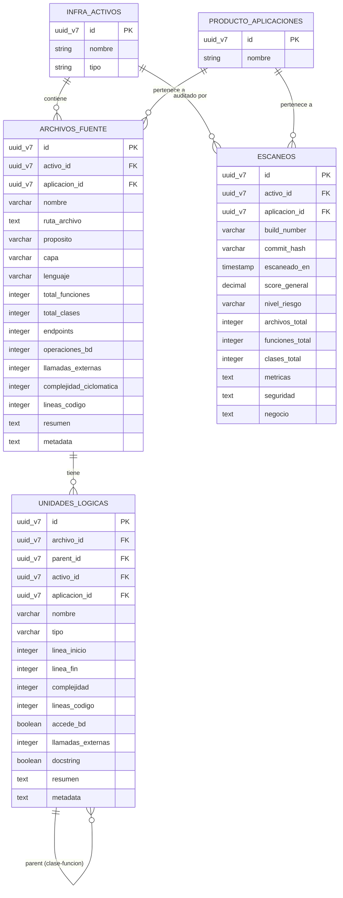

# 📋 Plan de Implementación Profesional — Code-Agent V1.0

> **Documento para compartir con el equipo técnico**
> Proyecto: Agente Inteligente de Mapeo y Documentación de Arquitectura
> Fecha: Marzo 2026 · Versión: 1.1 *(actualizado con schemas reales de A-ONE)*
> Sponsor: Javier Draxl · Equipo: Omar, Root, Stefano

---

## 1. Visión del Sistema

El Code-Agent es un **agente de ingeniería inversa** que analiza repositorios de microservicios para:

1. Descomponer cada microservicio en **unidades físicas** (archivos) y **unidades lógicas** (clases, funciones)
2. Diagnosticar calidad: atomicidad, transparencia, complejidad, capas arquitectónicas
3. Generar resúmenes en lenguaje natural y extraer reglas de negocio usando IA
4. Persistir todo en PostgreSQL para consulta estructurada desde A-ONE

**Resultado final:** Cada función de cada microservicio es un registro consultable con score de riesgo, capa arquitectónica, resumen en lenguaje natural y trazabilidad al activo padre.

---

## 2. Stack Tecnológico

### 2.1 Stack Core

| Capa | Tecnología | Versión | Justificación |
|---|---|---|---|
| **Lenguaje** | Python | 3.11+ | Ecosistema de IA maduro, parsers AST nativos |
| **Framework API** | FastAPI | 0.100+ | Async nativo, OpenAPI autodoc, validación con Pydantic |
| **ORM** | SQLAlchemy | 2.0+ | Soporte para múltiples schemas, async sessions |
| **Validación** | Pydantic | v2 | Modelos de dominio tipados, serialización JSON |
| **Base de datos** | PostgreSQL | 15+ | Producción A-ONE existente |
| **Cola de trabajos** | SQS o Celery+Redis | — | Procesamiento async, retry, dead-letter queue |

### 2.2 Stack de IA

| Modelo | Proveedor | Uso específico | Costo (1M tokens) |
|---|---|---|---|
| **Claude 3.5 Haiku** | AWS Bedrock | Clasificación de capas, resúmenes cortos | Input: $0.80 · Output: $4.00 |
| **Claude 3.5 Sonnet** | AWS Bedrock | Extracción de reglas de negocio, análisis OWASP | Input: $3.00 · Output: $15.00 |
| **GPT-4** | OpenAI | Fallback si Bedrock no disponible | Variable |

> [!TIP]
> **Estrategia tiered:** Haiku para tareas simples (clasificación, resúmenes) y Sonnet solo para razonamiento profundo (reglas de negocio). Reduce costos ~60%.

### 2.3 Herramientas de Análisis Estático

| Herramienta | Propósito | Integración |
|---|---|---|
| **AST nativo** (Python `ast`, JavaParser) | Parseo de código, extracción de clases/funciones/imports | Core del pipeline |
| **Lizard** | Complejidad ciclomática multi-lenguaje | `pip install lizard` |
| **Semgrep** | Detección de patrones OWASP (determinístico) | YAML rules — más preciso que LLM para seguridad |
| **Radon** | Halstead metrics, Maintainability Index (Python) | `pip install radon` |

> [!IMPORTANT]
> **Semgrep vs LLM para seguridad:** Semgrep usa reglas determinísticas (sin alucinaciones). Estrategia óptima: **Semgrep detecta → LLM explica** en lenguaje natural.

---

## 3. Arquitectura del Servicio

### 3.1 Diagrama General

```
 ┌─────────────────────────────────────────────────────────┐
 │                     TRIGGERS                            │
 │                                                         │
 │   ┌──────────────┐   ┌──────────────┐  ┌────────────┐  │
 │   │  API REST    │   │  CI/CD Step  │  │  Scheduler │  │
 │   │  POST /scan  │   │  (cualquier  │  │  (cron)    │  │
 │   │              │   │   pipeline)  │  │            │  │
 │   └──────┬───────┘   └──────┬───────┘  └─────┬──────┘  │
 └──────────┼──────────────────┼────────────────┼──────────┘
            │                  │                │
            ▼                  ▼                ▼
      ┌────────────────────────────────────────────┐
      │              SQS Queue                     │
      │         scan-requests                      │
      └─────────────────┬──────────────────────────┘
                        │
                        ▼
 ┌─────────────────────────────────────────────────────────┐
 │                   CODE-AGENT CORE                       │
 │                                                         │
 │   ┌─────────┐  ┌─────────┐  ┌────────┐  ┌──────────┐  │
 │   │  AST    │  │ Lizard  │  │Semgrep │  │  LLM     │  │
 │   │ Parsers │  │ Metrics │  │Security│  │ Enricher │  │
 │   └────┬────┘  └────┬────┘  └───┬────┘  └────┬─────┘  │
 │        └────────────┴───────────┴─────────────┘         │
 │                         │                               │
 │                         ▼                               │
 │                  ┌─────────────┐                        │
 │                  │  Pipeline   │                        │
 │                  │ Orchestrator│                        │
 │                  └──────┬──────┘                        │
 └─────────────────────────┼───────────────────────────────┘
                           │
              ┌────────────┼────────────┐
              ▼            ▼            ▼
        ┌──────────┐ ┌──────────┐ ┌──────────┐
        │PostgreSQL│ │ Bedrock  │ │CloudWatch│
        │infra_    │ │ Claude   │ │ Logs &   │
        │detalle.* │ │          │ │ Metrics  │
        └──────────┘ └──────────┘ └──────────┘
```

### 3.2 Trigger Principal: API REST (`POST /scan`)

> **Decisión de diseño:** El trigger es una API REST **agnóstica**. Sin dependencia de ningún SCM (Bitbucket, GitHub, etc.). Cualquier sistema puede invocarla.

#### Contrato del endpoint

```
POST /api/v1/scan

Request:
{
  "project_path": "C:/repos/acs-service",          // ruta local al repo
  "branch": "main",                                  // rama analizada
  "activo_id": "uuid-v7-del-activo-en-infra",       // FK a infra.activos
  "aplicacion_id": "uuid-v7-de-la-aplicacion",      // FK a producto.aplicaciones
  "microservice_name": "ACS",                        // nombre legible
  "repo_url": null                                    // FUTURO: URL Git remote
}

Response 202 (Accepted):
{
  "job_id": "uuid-v7",
  "status": "QUEUED",
  "estimated_duration_seconds": 60
}
```

#### Consultar estado del job

```
GET /api/v1/scan/{job_id}

Response 200:
{
  "job_id": "uuid-v7",
  "status": "COMPLETED",
  "scan_id": "uuid-v7-escaneo",
  "archivos_analizados": 72,
  "clases": 28,
  "funciones": 116,
  "score_general": 66.4,
  "nivel_riesgo": "HIGH",
  "duracion_segundos": 45,
  "errores": []
}
```

#### Otros triggers (futuro)

| Trigger | Cómo conecta | Cuándo implementar |
|---|---|---|
| **CI/CD Step** | `curl POST /api/v1/scan` desde cualquier pipeline | Automatización |
| **Scheduler** | EventBridge / Cron ejecuta `POST /scan` con lista de repos | Monitoreo periódico |
| **SCM Webhook** | Adaptador que normaliza webhook → `POST /scan` | Solo si se necesita real-time |

---

## 4. Fases de Implementación

### FASE 0 — Servicio base y API REST

**Objetivo:** Esqueleto del servicio con endpoint `POST /scan` y tracking de jobs.

**Entregables:**
- Proyecto FastAPI con estructura definitiva
- Endpoint `POST /api/v1/scan` y `GET /api/v1/scan/{job_id}`
- Tabla local `scan_jobs` para tracking de estado (puede ser SQLite o tabla interna)
- Health check endpoint (`GET /health`)
- Docker Compose para desarrollo local (API + PostgreSQL)
- Structured logging (JSON) con `structlog`

**Estructura del proyecto:**
```
code-agent/
├── src/
│   ├── api/
│   │   ├── main.py                  # FastAPI app
│   │   ├── routes/
│   │   │   ├── scan.py              # POST /scan, GET /scan/{id}
│   │   │   └── health.py            # GET /health
│   │   └── schemas/
│   │       ├── scan_request.py      # Pydantic request
│   │       └── scan_response.py     # Pydantic response
│   ├── core/
│   │   ├── analyzers/
│   │   │   ├── python_analyzer.py   # ✅ existente
│   │   │   ├── java_analyzer.py     # ✅ existente
│   │   │   ├── javascript_analyzer.py
│   │   │   ├── typescript_analyzer.py
│   │   │   ├── logical_unit_extractor.py
│   │   │   └── pipeline.py
│   │   ├── enricher/
│   │   │   └── llm_enricher.py      # Fase 2
│   │   └── security/
│   │       └── semgrep_runner.py     # Fase 2
│   ├── db/
│   │   ├── models.py                # ORM models
│   │   ├── repository.py            # Data access layer
│   │   └── session.py               # Conexión BD
│   ├── integrations/
│   │   ├── aone_client.py           # Cliente HTTP a endpoints A-ONE
│   │   ├── aone_graph.py            # Relaciones en grafo
│   │   └── scm_adapter.py           # Fase 4 (git clone)
│   ├── models/
│   │   └── domain.py                # Pydantic domain models
│   └── config.py                    # Settings
├── tests/
│   ├── unit/
│   ├── integration/
│   └── e2e/
├── docker-compose.yml
├── Dockerfile
├── pyproject.toml
└── .env.example
```

**Criterio de aceptación:**
- `POST /scan` con ruta local retorna `job_id` con status `QUEUED`
- `GET /scan/{job_id}` retorna estado actual
- Docker Compose levanta API + PostgreSQL en un solo comando

---

### FASE 1 — Parseo, Clasificación y Persistencia

**Objetivo:** Cada archivo del repo se descompone en unidades físicas y lógicas, todo persistido en las tablas reales de A-ONE.

**Entregables:**
- `logical_unit_extractor.py` produce jerarquía Archivo → Clase → Función
- `pipeline.py` orquesta el flujo completo con checkpointing por archivo
- `aone_client.py` persiste vía endpoints HTTP de A-ONE (o conexión directa a BD)
- Score y risk_level calculados y persistidos en `metadata` como JSON string

**Flujo del Pipeline Fase 1:**

```
Ruta local del repo
    │
    ▼
ProjectAnalyzerService.analyze_project()
    │  produce FileAnalysis × N archivos
    ▼
┌─── POR CADA ARCHIVO ─────────────────────────────┐
│                                                    │
│  logical_unit_extractor.extract(file_analysis)     │
│      ↓                                             │
│  ArchivoFuente + List[UnidadLogica]                │
│      ↓                                             │
│  aone_client.post_archivo_fuente()  ← HTTP POST    │
│  aone_client.post_unidades()        ← HTTP POST    │
│      ↓                                             │
│  ✅ Checkpoint: marcar archivo como procesado      │
│                                                    │
└────────────────────────────────────────────────────┘
    │
    ▼
_build_escaneo()  →  aone_client.post_escaneo()
    │
    ▼
Update scan_job status → COMPLETED
```

**Modelo de Scoring por función:**

```
overall_score = (atomicity × 0.4 + transparency × 0.4 + complexity_score × 0.2) × 100
```

| Componente | Peso | Qué mide | Penalizaciones |
|---|---|---|---|
| **Atomicity** | 40% | Tamaño y simplicidad | LOC > 30: -0.3 · Complexity > 10: -0.3 |
| **Transparency** | 40% | Separación de capas | DB calls: -0.4 · Infra imports: -0.3 |
| **Complexity Score** | 20% | Inverso de CC | `1.0 / max(complexity, 1)` |

| Risk Level | Condición |
|---|---|
| **HIGH** | complejidad > 15 **o** score < 50 |
| **MEDIUM** | complejidad ≥ 10 **o** score < 70 |
| **LOW** | resto |

> [!IMPORTANT]
> Los campos `overall_score`, `risk_level` y `capa` no existen como columnas directas en `unidades_logicas` de A-ONE. Se persisten dentro del campo `metadata` como JSON string serializado. Ver sección 5 para el mapeo exacto.

---

### FASE 2 — Enriquecimiento con IA

**Objetivo:** Cada unidad lógica de capa DOMINIO tiene resumen en lenguaje natural. Cada microservicio tiene reglas de negocio y hallazgos de seguridad.

**Entregables:**
- `llm_enricher.py` — llamada directa a Bedrock (sin agente autónomo)
- `semgrep_runner.py` — detección determinística de patrones OWASP
- Cache de respuestas LLM para evitar re-procesamiento
- Fallback graceful si Bedrock no está disponible

**Arquitectura del Enricher:**

```
┌─────────────────────────────────────────────────┐
│              POR CADA ARCHIVO                   │
│                                                  │
│  ┌────────────┐      ┌─────────────────────┐    │
│  │  Semgrep   │─────▶│ Hallazgos OWASP     │    │
│  │ (reglas    │      │ A03:Injection        │    │
│  │  YAML)     │      │ A02:Crypto Failures  │    │
│  └────────────┘      └──────────┬──────────┘    │
│                                  │               │
│  ┌────────────┐      ┌──────────▼──────────┐    │
│  │  Cache     │◀────▶│  LLM Enricher      │    │
│  │  DynamoDB  │      │                     │    │
│  │  o Redis   │      │  Haiku: resúmenes   │    │
│  │            │      │  Sonnet: reglas neg  │    │
│  └────────────┘      └──────────┬──────────┘    │
│                                  │               │
│                      ┌──────────▼──────────┐    │
│                      │ UPDATE en A-ONE     │    │
│                      │ unidades → resumen  │    │
│                      │ escaneos → negocio  │    │
│                      │ escaneos → seguridad│    │
│                      └─────────────────────┘    │
└─────────────────────────────────────────────────┘
```

**Prompt al LLM (input):**

```json
{
  "archivo": "LogicCard.java",
  "capa": "DOMINIO",
  "unidades": [
    {"nombre": "activarTarjeta", "tipo": "FUNCION", "complejidad": 8, "accede_bd": true}
  ],
  "hallazgos_semgrep": [
    {"regla": "A03:Injection", "linea": 45, "codigo": "...snippet..."}
  ],
  "codigo": "...código fuente..."
}
```

**Output esperado (JSON estricto):**

```json
{
  "unidades": [
    {
      "nombre": "activarTarjeta",
      "resumen": "Activa una tarjeta verificando estado previo y actualizando en BD",
      "reglas_negocio": [
        "Una tarjeta solo puede activarse si está en estado INACTIVA",
        "La activación genera un evento de auditoría"
      ]
    }
  ],
  "resumen_archivo": "Servicio de gestión del ciclo de vida de tarjetas"
}
```

**Estrategia de Cache LLM:**

| Elemento | Detalle |
|---|---|
| **Cache key** | `SHA256(código_fuente + prompt_version)` |
| **Storage** | DynamoDB o Redis con TTL 30 días |
| **Invalidación** | Automática cuando el archivo cambia (nuevo hash) |
| **Ahorro** | ~95% de llamadas LLM en re-escaneos con pocos cambios |

---

### FASE 3 — Integración con A-ONE y Grafo

**Objetivo:** Los datos son consumibles por el frontend de A-ONE. Las relaciones de infraestructura se crean en el grafo.

**Entregables:**
- Configuración de entidades en backend genérico de A-ONE (ya está — endpoints existentes)
- Módulo `aone_graph.py` para relaciones en el grafo
- Vista materializada para dashboards

**Relaciones en el Grafo:**

```
infra.activos (Lambda/ECS)
    │
    ├── REL-INFRA-05: CONTIENE → archivos_fuente
    │
    └── REL-INFRA-34: ACCEDE   → activo AWS (S3, SQS, DynamoDB)
```

---

### FASE 4 — Cobertura Multi-Repositorio

**Objetivo:** Escaneo automatizado de los 5 microservicios críticos.

**Entregables:**
- `scm_adapter.py` — abstracción de `git clone` (agnóstico de SCM)
- Endpoint `POST /api/v1/scan/batch` para escaneos múltiples
- Agente batch con AWS Strands para orquestación multi-repo
- Validación automática post-escaneo

**Microservicios target:**

| Microservicio | Repo | Prioridad |
|---|---|---|
| ACS | `acs-service` | 🔴 Crítico |
| Orquestador | `orchestrator-service` | 🔴 Crítico |
| PSE | `pse-service` | 🟡 Alto |
| OSE | `ose-service` | 🟡 Alto |
| Transaction Key | `transaction-key` | 🟡 Alto |

---

## 5. Base de Datos — Schemas Reales de A-ONE

> [!IMPORTANT]
> Las tablas viven en el schema **`infra_detalle`** de la BD de A-ONE, no en schemas `code`/`quality` como se planteaba originalmente. El Code-Agent escribe a través de los **endpoints HTTP existentes** o directamente a las tablas.

### 5.1 Endpoints Reales de A-ONE (Producción)

```
Base URL: https://lrxgmddycqvq3ql6vqgct3p5za0ityil.lambda-url.us-east-1.on.aws/alignetone_dev_v2

Entidades:
├── /entities/archivos_fuente     → infra_detalle.archivos_fuente
├── /entities/unidades_logicas    → infra_detalle.unidades_logicas
└── /entities/escaneos            → infra_detalle.escaneos
```

### 5.2 Tabla `infra_detalle.archivos_fuente`

**1 registro por archivo del repositorio.**

| Columna | Tipo Real | Required | Fuente de datos |
|---|---|---|---|
| `id` | UUID_V7 | ✅ PK | `gen_random_uuid_v7()` auto |
| `activo_id` | UUID_V7 | ✅ FK→`infra.activos` | Parámetro del scan request |
| `aplicacion_id` | UUID_V7 | ✅ FK→`producto.aplicaciones` | Parámetro del scan request |
| `nombre` | VARCHAR(255) | ✅ | `file_analysis.file_name` |
| `ruta_archivo` | TEXT | | `file_analysis.file_path` |
| `proposito` | VARCHAR(30) | | Clasificación del parser: Controller, Service, Repository, Model, Config |
| `capa` | VARCHAR(20) | | Pipeline scoring: `Dominio`, `Infraestructura`, `Adaptador` |
| `lenguaje` | VARCHAR(20) | | `file_analysis.language`: Java, Python, JavaScript, TypeScript |
| `total_funciones` | INTEGER | | `len(file_analysis.functions)` |
| `total_clases` | INTEGER | | `len(file_analysis.classes)` |
| `endpoints` | **INTEGER** | | `len(file_analysis.api_endpoints)` — es **conteo**, no JSONB |
| `operaciones_bd` | **INTEGER** | | `len(file_analysis.database_calls)` — es **conteo**, no JSONB |
| `llamadas_externas` | **INTEGER** | | `len(file_analysis.external_calls)` — es **conteo**, no JSONB |
| `complejidad_ciclomatica` | INTEGER | | `file_analysis.complexity` o sum de funciones |
| `lineas_codigo` | INTEGER | | `file_analysis.total_lines` |
| `resumen` | TEXT | | Generado por LLM (Fase 2) — `null` en Fase 1 |
| `metadata` | **TEXT** | | JSON string con datos extra (ver abajo) |
| `build_number` | VARCHAR(20) | | Parámetro opcional o Bitbucket API |
| `commit_hash` | VARCHAR(40) | | `git rev-parse HEAD` |
| `escaneado_en` | TIMESTAMP | | `CURRENT_TIMESTAMP` |
| `activo` | BOOLEAN | | `true` por defecto |
| `created_at` | TIMESTAMP | | Auto |
| `updated_at` | TIMESTAMP | | Auto |

**Campo `metadata` (TEXT — JSON serializado):**
```json
{
  "imports": ["boto3", "sqlalchemy", "fastapi"],
  "decorators": ["@app.route", "@inject"],
  "api_endpoints_detail": [{"method": "POST", "path": "/api/cards"}],
  "database_calls_detail": [{"tipo": "SELECT", "tabla": "tarjetas"}],
  "external_calls_detail": [{"servicio": "S3", "operacion": "put_object"}]
}
```

> [!WARNING]
> `endpoints`, `operaciones_bd` y `llamadas_externas` son **INTEGER** (conteos) en la BD real, no arrays JSONB. El detalle se guarda en `metadata` como JSON string. El pipeline debe convertir: `json.dumps(detail_dict)` antes de persistir.

---

### 5.3 Tabla `infra_detalle.unidades_logicas`

**1 registro por clase o función.**

| Columna | Tipo Real | Required | Fuente de datos |
|---|---|---|---|
| `id` | UUID_V7 | ✅ PK | `gen_random_uuid_v7()` auto |
| `archivo_id` | UUID_V7 | ✅ FK→`archivos_fuente` | ID del archivo padre |
| `parent_id` | UUID_V7 | FK→`unidades_logicas` | UUID de la clase padre (null si standalone o si ES clase) |
| `activo_id` | UUID_V7 | ✅ FK→`infra.activos` | Desnormalizado del archivo padre |
| `aplicacion_id` | UUID_V7 | ✅ FK→`producto.aplicaciones` | Desnormalizado del archivo padre |
| `nombre` | VARCHAR(255) | ✅ | `"AREQAdapter"`, `"adapt"`, `"_map_currency"` |
| `tipo` | VARCHAR(20) | ✅ | `CLASE`, `FUNCION`, `INTERFAZ`, `ENUM` |
| `linea_inicio` | INTEGER | | Línea donde empieza la unidad en el archivo |
| `linea_fin` | INTEGER | | Línea donde termina la unidad en el archivo |
| `complejidad` | INTEGER | | Complejidad ciclomática de la unidad |
| `lineas_codigo` | INTEGER | | LOC de la unidad |
| `accede_bd` | BOOLEAN | | `true` si tiene database calls |
| `llamadas_externas` | **INTEGER** | | Conteo de llamadas externas |
| `docstring` | BOOLEAN | | `true` si tiene docstring/javadoc |
| `resumen` | TEXT | | Generado por LLM (Fase 2) — `null` en Fase 1 |
| `metadata` | **TEXT** | | JSON string con scoring y datos extra (ver abajo) |
| `activo` | BOOLEAN | | `true` por defecto |
| `created_at` | TIMESTAMP | | Auto |
| `updated_at` | TIMESTAMP | | Auto |

**Campo `metadata` de unidades_logicas (TEXT — JSON serializado):**

> [!IMPORTANT]
> Las columnas `capa`, `overall_score`, `risk_level`, `compliance` y `proposito` **no existen** como columnas directas en la tabla real. Se persisten dentro de `metadata`.

```json
{
  "capa": "DOMINIO",
  "proposito": "Lógica de activación de tarjetas",
  "overall_score": 66.4,
  "risk_level": "HIGH",
  "compliance": {
    "loc_ok": true,
    "complexity_ok": false,
    "has_multi_layer_coupling": false
  },
  "imports": ["boto3.s3", "sqlalchemy"],
  "decorators": ["@transactional"],
  "parameters": ["card_id: str", "status: str"],
  "return_type": "CardResponse",
  "reglas_negocio": [
    "Una tarjeta solo puede activarse si está en estado INACTIVA"
  ]
}
```

**Ejemplo de jerarquía insertada:**

```
archivo_id: uuid-F1 (areq_adapter.py)
├── id: uuid-C1, tipo=CLASE,   nombre="AREQAdapter",   parent_id=NULL,    linea_inicio=5,  linea_fin=120
│   ├── id: uuid-U1, tipo=FUNCION, nombre="adapt",          parent_id=uuid-C1, linea_inicio=10, linea_fin=45
│   └── id: uuid-U2, tipo=FUNCION, nombre="_map_currency",  parent_id=uuid-C1, linea_inicio=50, linea_fin=80
└── id: uuid-U3, tipo=FUNCION, nombre="standalone_func", parent_id=NULL,    linea_inicio=125, linea_fin=140
```

---

### 5.4 Tabla `infra_detalle.escaneos`

**1 snapshot por ejecución del pipeline.**

| Columna | Tipo Real | Required | Fuente de datos |
|---|---|---|---|
| `id` | UUID_V7 | ✅ PK | `gen_random_uuid_v7()` auto |
| `activo_id` | UUID_V7 | ✅ FK→`infra.activos` | Parámetro del scan request |
| `aplicacion_id` | UUID_V7 | ✅ FK→`producto.aplicaciones` | Parámetro del scan request |
| `build_number` | VARCHAR(20) | | Parámetro opcional |
| `commit_hash` | VARCHAR(40) | | `git rev-parse HEAD` |
| `escaneado_en` | TIMESTAMP | | `CURRENT_TIMESTAMP` |
| `generado_por` | VARCHAR(100) | | `"code-agent-v1.0"` |
| `score_general` | DECIMAL(5,2) | | Promedio de scores de todas las unidades |
| `nivel_riesgo` | VARCHAR(10) | ✅ | `LOW`, `MEDIUM`, `HIGH` — basado en score_general |
| `archivos_total` | INTEGER | | Count de archivos analizados |
| `funciones_total` | INTEGER | | Count de unidades tipo FUNCION |
| `clases_total` | INTEGER | | Count de unidades tipo CLASE |
| `dominios_negocio` | **TEXT** | | JSON string: `'["pagos", "tarjetas", "autenticación"]'` |
| `metricas` | **TEXT** | | JSON string con métricas agregadas (ver abajo) |
| `arquitectura` | **TEXT** | | JSON string con distribución de capas |
| `seguridad` | **TEXT** | | JSON string con hallazgos OWASP (Semgrep) |
| `rendimiento` | **TEXT** | | JSON string con métricas de performance |
| `negocio` | **TEXT** | | JSON string con reglas de negocio extraídas |
| `cumplimiento` | **TEXT** | | JSON string con compliance checklist |
| `created_at` | TIMESTAMP | | Auto |
| `updated_at` | TIMESTAMP | | Auto |

**Campos TEXT con JSON serializado en `escaneos`:**

```json
// metricas
{
  "loc_total": 5200,
  "avg_complexity": 8.3,
  "max_complexity": 22,
  "avg_score": 66.4,
  "languages": {"Java": 45, "Python": 27}
}

// arquitectura
{
  "capas": {"dominio": 45, "infraestructura": 20, "adaptador": 7},
  "multi_layer_count": 3
}

// seguridad (Fase 2, Semgrep + LLM)
{
  "owasp": [
    {"regla": "A03:2021", "nombre": "Injection", "archivo": "UserDAO.java", "linea": 45, "severidad": "HIGH"},
    {"regla": "A02:2021", "nombre": "Crypto Failures", "archivo": "auth.py", "linea": 12, "severidad": "MEDIUM"}
  ],
  "total_hallazgos": 2
}

// negocio (Fase 2, LLM)
{
  "reglas": [
    {"texto": "Una tarjeta solo puede activarse si está en estado INACTIVA", "funcion": "activarTarjeta", "archivo": "LogicCard.java"},
    {"texto": "El monto máximo por transacción es 10,000 USD", "funcion": "validateAmount", "archivo": "TransactionValidator.java"}
  ],
  "total_reglas": 2
}

// cumplimiento
{
  "loc_ok_pct": 85,
  "complexity_ok_pct": 72,
  "docstring_pct": 45,
  "multi_layer_violations": 3
}
```

### 5.5 Diagrama Entidad-Relación (Esquema Real)



### 5.6 Cómo persiste el Code-Agent — doble vía

| Método | Cuándo usar | Ventaja |
|---|---|---|
| **HTTP POST** a endpoints A-ONE | Default — sin acceso directo a BD | Desacoplado, usa la API existente |
| **Conexión directa** (SQLAlchemy) | Si el volumen es alto y HTTP es lento | Bulk insert, transacciones |

```python
# Ejemplo: POST a endpoint A-ONE
import httpx

AONE_BASE = "https://lrxgmddycqvq3ql6vqgct3p5za0ityil.lambda-url.us-east-1.on.aws/alignetone_dev_v2"

async def post_archivo_fuente(archivo: dict) -> dict:
    async with httpx.AsyncClient() as client:
        resp = await client.post(f"{AONE_BASE}/entities/archivos_fuente", json=archivo)
        resp.raise_for_status()
        return resp.json()
```

---

## 6. Observabilidad

| Área | Herramienta | Qué se mide |
|---|---|---|
| **Logs** | CloudWatch + `structlog` (JSON) | Cada archivo procesado, errores, duración |
| **Métricas** | CloudWatch Metrics | Archivos/min, llamadas LLM, tasa de error |
| **Tracing** | AWS X-Ray u OpenTelemetry | Latencia por etapa: parseo → scoring → LLM → BD |
| **Alertas** | CloudWatch Alarms | Job FAILED, latencia LLM > 30s, error rate > 5% |

> [!WARNING]
> **Nunca logear código fuente** — solo metadata (rutas, métricas, scores). El código es propiedad intelectual sensible.

---

## 7. Seguridad

| Área | Implementación |
|---|---|
| Credenciales Git | AWS Secrets Manager con rotación automática |
| Credenciales BD | IAM Database Authentication |
| Código clonado | Directorio temporal, borrado en `finally` block |
| API del servicio | API Gateway + IAM Auth o Cognito |
| Acceso a repos | Solo lectura — nunca push/write |
| Datos en BD | Encryption at rest (RDS default) |

---

## 8. CI/CD del Code-Agent

```
Push a main (Code-Agent repo)
    │
    ├── 1. Lint + Type Check (ruff, mypy)
    ├── 2. Unit Tests (pytest)
    ├── 3. Integration Tests (pytest + testcontainers-postgres)
    ├── 4. Docker build
    ├── 5. ECR push
    └── 6. ECS deploy (blue/green)
```

---

## 9. Resumen de Entregables por Fase

| Fase | Entregable principal | Componentes nuevos | Dependencias |
|---|---|---|---|
| **0** | Servicio API + jobs | `api/`, Docker Compose | Ninguna |
| **1** | Parseo + persistencia A-ONE | `pipeline.py`, `aone_client.py`, `logical_unit_extractor.py` | Fase 0, endpoints A-ONE |
| **2** | Enriquecimiento IA + seguridad | `llm_enricher.py`, `semgrep_runner.py`, cache | Fase 1, acceso Bedrock |
| **3** | Grafo + dashboards | `aone_graph.py`, materialized views | Fase 2, backend A-ONE |
| **4** | Multi-repo + batch | `scm_adapter.py`, Strands batch | Fase 3, acceso Git repos |

---

## 10. Criterios de Aceptación Globales

- [ ] `archivos_fuente` tiene 1 registro por archivo `.py`/`.java` del repo
- [ ] `unidades_logicas` tiene jerarquía correcta (CLASE → FUNCION con `parent_id`)
- [ ] `unidades_logicas.metadata` contiene `overall_score`, `risk_level`, `capa`
- [ ] `escaneos` tiene `score_general`, `nivel_riesgo` poblados
- [ ] Unidades de capa DOMINIO tienen `resumen` generado por LLM
- [ ] `escaneos.negocio` tiene reglas de negocio extraídas (JSON string)
- [ ] `escaneos.seguridad` tiene hallazgos Semgrep (JSON string)
- [ ] Los 5 microservicios críticos escaneados
- [ ] API `POST /scan` funcional con respuesta async
- [ ] Sin dependencia directa de ningún SCM — trigger agnóstico
- [ ] Cobertura de tests > 80%
- [ ] `aplicacion_id` siempre presente en los 3 tipos de registro

---

*Documento de implementación — Code-Agent V1.0 — Alignet Ecosistema de Pagos Digitales*
*Para revisión del equipo técnico — Marzo 2026 — v1.1 (con schemas reales)*
